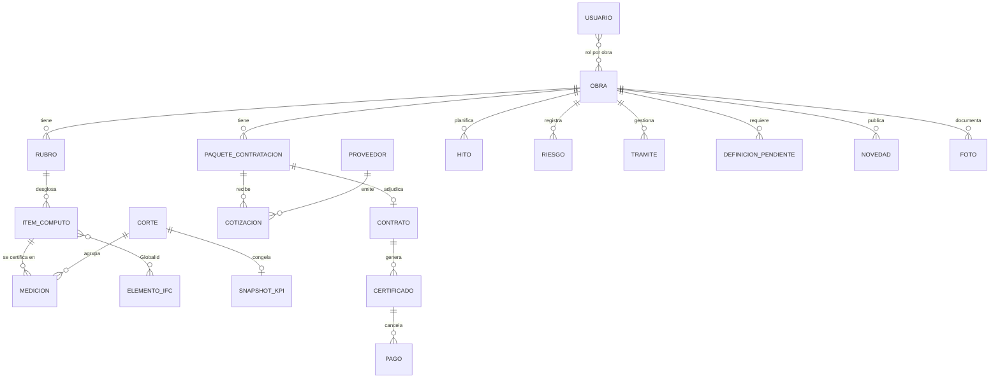

# Centro de Control de Obra · Las Heras 1832 — Spec de módulos (borrador v0.1)

> Evolución del visor BIM de LH1832 hacia un tablero de gestión de obra.
> Audiencia principal: **gerencia e inversores**. Fuente de datos: **base propia** dentro de la aplicación.
> Estado: borrador para discusión — 2026-10-11.

---

## 1. Punto de partida

El sitio actual (`croklin09/lh1832`, GitHub Pages, estático) ya resuelve:

| Componente | Implementación actual | Reutilizable |
|---|---|---|
| Visor 3D | Three.js 0.180 + web-ifc 0.0.78, capas IFC con opacidad, cortes X/Y/Z | Sí, pasa a ser el módulo **Avance físico 3D** |
| Avance | Barra = elementos con `Certificated = TRUE` / total (Pset `KORN_Avance`) | Sí, pero hay que **ponderar** el conteo (ver §4) |
| Novedades | `novedades.json` + PDF mensual (pdf.js) | Sí, módulo **Informes** |
| Brochure | PDF estático | Sí, módulo **Documentos** |

**Limitaciones para un centro de control:**
- No hay backend: los datos están dentro del repo y el repo es **público**. Ningún dato económico ni contractual puede vivir ahí.
- No hay autenticación ni roles.
- El avance cuenta elementos (una columna pesa lo mismo que una losa) y solo cubre estructura y escaleras. No refleja avance económico ni el de rubros húmedos o de terminaciones.

---

## 2. Objetivo y alcance

**Objetivo:** que un inversor o gerente responda en menos de 1 minuto:
1. ¿Cuánto avanzó la obra y cuánto debería haber avanzado?
2. ¿Cuánto se gastó o comprometió contra el presupuesto?
3. ¿Llegamos a la fecha de entrega? ¿Qué lo pone en riesgo?
4. ¿Qué decisiones están pendientes y de quién dependen?

**En alcance:** vista ejecutiva, avance físico y económico, cronograma de hitos, contrataciones, riesgos y bloqueos, trámites, informes y fotos.
**Fuera de alcance v1:** gestión operativa diaria (partes diarios, asistencia de personal, pedidos de materiales). Sigue en Notion `✅ ARQ` y se resume acá solo a nivel de bloqueos.

---

## 3. Módulos

### M0 · Resumen ejecutivo (home)
Fila de KPIs, con tendencia contra el corte anterior:

| KPI | Fórmula | Semáforo |
|---|---|---|
| Avance físico real | Σ (peso_rubro × avance_rubro) | — |
| Avance planificado | según línea base a la fecha de corte | — |
| SPI (desempeño de plazo) | EV / PV | ≥0,95 🟢 · 0,85–0,95 🟡 · <0,85 🔴 |
| CPI (desempeño de costo) | EV / AC | ≥1 🟢 · 0,95–1 🟡 · <0,95 🔴 |
| Presupuesto ejecutado | AC / BAC | — |
| Fecha de fin estimada | fecha_corte + (duración_restante / SPI) | desvío en días vs línea base |
| Comprometido | contratos + OC firmados / BAC | % del presupuesto ya contratado |
| Bloqueos críticos abiertos | count(riesgo.estado = abierto AND impacto = alto) | — |

Debajo de los KPIs van la **curva S** (PV, EV y AC acumulados) y la lista de los **5 riesgos o bloqueos** con mayor impacto.

### M1 · Avance físico
- **Matriz rubro × piso** (heatmap 0–100 %): es la vista que más usa un inversor para entender en qué etapa está la obra.
  Ejemplo con el informe de 2026-09: revoques exteriores en pisos 13–15, yesería en pisos 2, 3, 12 y 13, preinstalación de AA hasta el piso 13.
- **Visor 3D (el actual), extendido:** colorea por rubro o por fecha de certificación, no solo certificado sí/no. Tiene un control de fecha para ver el estado de la obra en un corte anterior (4D liviano).
- Avance por rubro con su peso dentro del total.

### M2 · Económico-financiero
- Presupuesto base (BAC) por rubro, en ARS y USD.
- Certificado (EV), pagado (AC) y comprometido (contratos y OC).
- **Redeterminación:** presupuesto actualizado por índice CAC y desvío que se explica por inflación contra el desvío real.
- Flujo de fondos: proyectado contra real, con necesidades de aporte por mes (clave para inversores).
- Desvíos por rubro, ordenados por impacto en USD.

### M3 · Cronograma e hitos
- Hitos con su fecha de línea base, la fecha prevista y la real (Gantt resumido, no el cronograma completo).
- Hitos sugeridos para LH1832: fin de estructura · cierre de mampostería · fin de revoques exteriores · cielorrasos · carpinterías · montaje de ascensores · conexiones de servicios (AySA, energía eléctrica) · final de obra · posesión.
- Línea de "hoy" y un indicador del camino crítico.

### M4 · Contrataciones y compras
Embudo por paquete de contratación: **Por cotizar → Cotizando → Comparativa → Adjudicado → En ejecución → Cerrado**.
- Por paquete: cantidad de cotizaciones, monto adjudicado contra el monto presupuestado y fecha límite de adjudicación según el cronograma.
- Alerta cuando un paquete no está adjudicado y faltan menos de N días para su fecha de inicio prevista.
- Se conecta con la skill de cuadro comparativo de presupuestos: la comparativa se adjunta al paquete.

### M5 · Riesgos, bloqueos y trámites
- Registro de riesgos: probabilidad × impacto, con responsable, mitigación y fecha de revisión.
- **Bloqueos externos y trámites:** factibilidades y conexiones de servicios, aprobaciones de instalaciones y medidores, con avance del trámite y organismo.
- **Definiciones pendientes de Proyecto:** cada una con la fecha en que tiene que estar definida para no frenar la obra.

### M6 · Informes y registro visual
- Novedades actuales (PDF mensual): sin cambios.
- Galería de fotos por fecha, piso y rubro, para comparar el antes y el después.
- **Cierre mensual:** al publicar el informe se congela un snapshot de los KPIs. Así el histórico no cambia cuando se editan datos.

### M7 · Documentos
Brochure, planos aprobados, actas de obra en PDF y contratos (estos últimos solo para gerencia).

### M8 · Comercial (opcional, a confirmar)
Unidades vendidas, reservadas y disponibles, y la cobranza contra el flujo de fondos de obra.

---

## 4. Avance ponderado (corrección del cálculo actual)

Hoy: `avance = elementos_certificados / elementos_totales`.

Propuesta:
```
avance_obra  = Σ_r  w_r · a_r          (w_r = BAC_r / BAC, Σ w_r = 1)
a_r          = Σ_i  q_i,cert / Σ_i q_i  (q = cantidad del ítem del cómputo: m², m³, ml, u)
```
- El IFC sigue siendo el soporte visual. El número sale de la base de datos (cómputo + certificaciones), no del conteo de elementos.
- Vínculo IFC ↔ base: `GlobalId` del elemento → `item_computo`. El Pset `KORN_Avance` se extiende con `Rubro`, `Piso` y `ItemComputo`.

---

## 5. Modelo de datos



Campos clave (resumen):

| Entidad | Campos |
|---|---|
| `rubro` | código, nombre, BAC_ars, BAC_usd, peso |
| `item_computo` | rubro_id, piso, unidad, cantidad, precio_unit |
| `medicion` | item_id, corte_id, cantidad_acum, fecha, autor |
| `corte` | fecha, estado (abierto/cerrado), índice_CAC, TC |
| `paquete_contratacion` | rubro_id, alcance, estado, fecha_límite_adj, monto_presup |
| `cotizacion` | paquete_id, proveedor_id, monto, moneda, validez, archivo |
| `hito` | nombre, fecha_base, fecha_prevista, fecha_real, crítico |
| `riesgo` | tipo (riesgo/bloqueo), prob, impacto, responsable, mitigación, estado |
| `tramite` | organismo, tipo, avance_%, próximo_paso, fecha_obj |
| `definicion_pendiente` | tema, área (Proyecto/Comercial/Gerencia), fecha_necesaria, estado |
| `auditoria` | entidad, id, campo, valor_ant, valor_nuevo, usuario, ts |

---

## 6. Cómo entra una nota de obra al tablero (ejemplo: recorrida 7/10)

| Tema de la nota | Módulo | Registro |
|---|---|---|
| Ampliación de red de agua (prioritario) | M5 | `tramite` organismo = AySA, crítico, vinculado al hito "Conexiones de servicios" |
| Bombas: 1 cotización recibida, falta la 2ª | M4 | `paquete` Bombas: estado Cotizando (1/2) |
| Pintura exterior: cotizar | M4 | `paquete` Pintura exterior: Por cotizar |
| Puertas: compra | M4 | `paquete` Puertas: Adjudicado o En compra |
| Herrería: escaleras y narices del dúplex | M4 | `paquete` Herrería dúplex |
| Cerrar baños (contratista sanitario) | M1 | `medicion` rubro Sanitaria |
| IIEE: pleno de cielorrasos, aprobación de cámara al 80 % | M5 / M1 | `tramite` cámara 80 %; `medicion` IIEE cielorrasos |
| Medidores: requieren asesoramiento | M5 | `riesgo` técnico, abierto |
| Revoque grueso de escalera; acopio en pisos 14/15 | M1 | `medicion` revoques |
| Dúplex: subir materiales grandes | M5 | `riesgo` logístico (izaje antes del cierre) |
| Nichos y detalles de mobiliario | M5 | `definicion_pendiente` área = Proyecto |

Flujo: nota en Obsidian → skill `leer-notas-obsidian` → tareas en Notion `✅ ARQ` (operativo). Solo lo que mueve un KPI, un hito o un riesgo se carga en el tablero, por formulario o import, con la validación de un editor.

---

## 7. Roles

| Rol | Ve | Edita |
|---|---|---|
| Inversor | M0, M1, M3, M6, M7 (públicos) · M2 resumido (sin precios unitarios ni proveedores) | — |
| Gerencia | Todo | Hitos, riesgos, definiciones |
| Dirección de obra | Todo | Mediciones, paquetes, trámites, fotos, novedades |
| Admin | Todo | Usuarios, línea base, cierre de corte |

Regla: **la línea base y los cortes cerrados son inmutables.** Para corregirlos se hace un re-baseline explícito, que queda registrado en la auditoría.

---

## 8. Arquitectura técnica propuesta

```
[Browser]  Visor IFC (Three.js + web-ifc, existente) + Tablero
     │  HTTPS + sesión
[Vercel]   Front estático + API (serverless)  ← ya existe el proyecto "lh1832"
     │
[Postgres] (Neon/Supabase vía Vercel Marketplace)  · RLS por rol
[Blob]     Fotos, PDFs de cotizaciones/contratos (privados)
```
- **Hosting:** migrar de GitHub Pages a Vercel. GitHub Pages no permite autenticación ni API.
- **Auth:** magic link por email con roles en la tabla `usuario_obra`.
- **Datos sensibles:** nunca en el repo, porque el repo es público. Los IFC y el brochure pueden seguir ahí.
- **Carga:** formularios web para Dirección de obra, más import CSV o XLSX para la línea base y el cómputo.
- **Cálculos:** las vistas SQL generan los KPIs y el `SNAPSHOT_KPI` se congela al cerrar el corte.
- **Multi-obra:** el modelo tiene `obra_id` desde el día 1, así sirve para Ortega y Gasset 1957 y para obras futuras.

---

## 9. Roadmap

| Fase | Contenido | Resultado |
|---|---|---|
| F1 · MVP | Auth + roles, M0 (sin económico), M3 hitos, M5 riesgos/trámites, M6 actual | Inversor ve plazo y riesgos |
| F2 · Avance real | Cómputo + mediciones, avance ponderado, matriz rubro × piso, curva S física | Reemplaza el avance por conteo |
| F3 · Económico | BAC, certificados, pagos, CAC, flujo de fondos, SPI/CPI | Vista financiera completa |
| F4 · BIM 4D | Vínculo IFC ↔ ítem, color por rubro/fecha, control de fecha | Visor conectado a datos |
| F5 · Contrataciones + Comercial | M4 completo, M8 | Opcional según prioridad |

---

## 10. Preguntas abiertas

1. ¿Existe una **línea base** (cronograma y presupuesto por rubro) cargable en Excel o Project? Sin ella no hay PV, SPI ni curva S.
2. ¿Moneda de control para inversores: USD, ARS o ARS ajustado por CAC?
3. ¿Los inversores ven **montos** o solo porcentajes?
4. ¿Frecuencia de corte: mensual (alineada al informe) o quincenal?
5. ¿Se incluye el módulo Comercial (M8)?
6. ¿Una sola obra (LH1832) o portfolio Korn desde el inicio?
