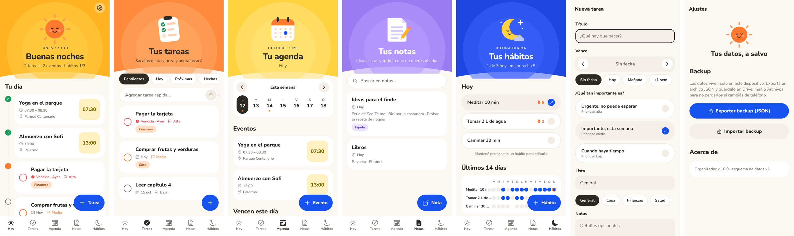
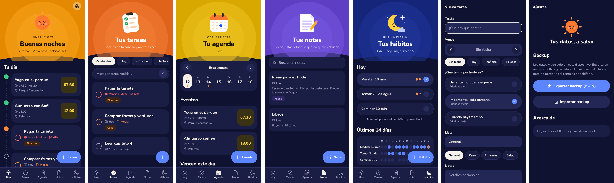

# Organizador

App móvil nativa (iOS / Android) de organización personal: **tareas, agenda, notas y hábitos**.
Datos 100 % locales en el dispositivo (SQLite) con backup manual a JSON.




## Stack

| Capa | Elección | Motivo |
|---|---|---|
| Runtime | Expo SDK 57 · React Native 0.86 · React 19 | Un solo código para iOS y Android, builds en la nube con EAS |
| Navegación | Expo Router (rutas por archivo en `src/app/`) | Pestañas + modales sin configuración manual |
| Datos | `expo-sqlite` con migraciones versionadas (`PRAGMA user_version`) | Consultas por fecha e índices; sin backend ni cuentas |
| Backup | `expo-file-system` + `expo-sharing` | Exporta JSON a Drive/mail/Archivos; importa desde el selector de archivos |
| UI | Nunito (`@expo-google-fonts`), `react-native-svg` | Tipografía redondeada e ilustraciones vectoriales propias |

## Diseño

Estética cálida y amable, inspirada en apps de bienestar:

- **Paleta:** fondo crema, acentos naranja y amarillo, azul para las acciones principales. En modo oscuro, azul noche.
- **Un color por módulo** (`theme.ts → accents`): Hoy amarillo-sol, Tareas naranja, Agenda amarillo, Notas lila, Hábitos azul noche.
- **Encabezado `Hero`:** ilustración sobre halos de luz y borde inferior curvo.
- **Tarjetas tipo sesión** (`SessionCard`): título grande, metadatos con ícono y un mosaico de color a la derecha.
- **Filas de opción** (`OptionRow`): píldoras con check a la derecha para hábitos y prioridad.
- **Línea de tiempo** en *Hoy*: punto naranja en el paso actual, check verde en lo hecho.
- **Tipografía:** usar siempre `Text` / `Input` de `components/ui`. Traducen `fontWeight` a la familia de Nunito
  correspondiente, porque en Android `fontWeight` no elige el archivo de una fuente custom.

## Integraciones (v1.1)

- **Calendario del teléfono** (`expo-calendar`, en dos sentidos). Al activarlo en Ajustes, la fuente de verdad de los
  eventos pasa a ser el calendario del sistema (Google, Xiaomi…): Organizador lee y escribe ahí, sin copias que
  sincronizar. Los eventos locales existentes se mueven al calendario elegido. Las series repetidas y los eventos de
  varios días se muestran pero se editan desde la app de calendario. Ojo: en Android los eventos de todo el día están
  a medianoche UTC; `lib/calendarMapping.ts` los lee en UTC para que no se corran un día en UTC−3.
- **Cashew** (sin API): se importa el CSV que exporta Cashew (`db/cashew.ts`). Se excluyen "Corrección de saldo"
  (transferencias y ajustes) y préstamos (`credit`/`debt`), igual que en los totales de Cashew. Reimportar reemplaza
  los días del archivo. Se guardan los rangos importados: un día sin gastos dentro de un rango vale $0, fuera de
  cualquier rango es "sin datos".
- **Ánimo diario** (1–5) desde *Hoy*.
- **Estadísticas** (`lib/insights.ts`, puro): gasto por día, gasto según ánimo y cruces hábito × gasto,
  hábito × ánimo y ánimo × gasto. Excluye el día de hoy, compara solo una moneda y exige al menos 4 días por grupo y una
  diferencia relevante antes de mostrar un hallazgo.

## Estructura

```
src/
  app/                    Rutas (cada archivo es una pantalla)
    _layout.tsx           SQLiteProvider + Stack raíz
    (tabs)/               Hoy · Tareas · Agenda · Notas · Hábitos
    tarea/[id].tsx        Editor (id = "nueva" para crear)
    evento/[id].tsx       Editor (id = "nuevo")
    nota/[id].tsx         Editor con autoguardado al salir
    habito/[id].tsx       Editor (id = "nuevo")
    ajustes.tsx           Calendario, Cashew y backup
    estadisticas.tsx      Gastos × hábitos × ánimo
  db/
    schema.ts             Esquema + migraciones
    repo.ts               Consultas por entidad, cálculo de rachas
    backup.ts             Export / validación / restore transaccional
    cashew.ts             Importador del CSV de Cashew
  components/             Tema, kit de UI, tarjetas, gráficos e ilustraciones SVG
  lib/                    Fechas, useQuery, eventos (local/teléfono), insights, montos
tests/db.test.mts         Tests de la capa de datos sobre SQLite real (Node)
```

## Modelo de datos

- **tasks**: título, notas, lista (Casa, Salud…), prioridad 1–3, vencimiento opcional, hecha.
- **events**: fecha, hora inicio/fin opcionales (sin hora = todo el día), lugar, notas.
- **notes**: título, cuerpo, fijada.
- **habits**: nombre, días de la semana como máscara de bits (bit 0 = lunes).
- **habit_logs**: (habit_id, fecha) por cada día cumplido. Borrado en cascada con el hábito.

Las fechas se guardan como `YYYY-MM-DD` en hora local, así el orden de texto coincide con el cronológico.

**Racha de un hábito:** días programados consecutivos cumplidos hacia atrás desde hoy. Si hoy está programado
y todavía no se marcó, no corta la racha. Los días no programados se saltean.

## Desarrollo

```bash
npm install
npx expo start          # abrir con Expo Go o con un development build
npm run typecheck
npm run lint
npm run test:db         # datos, Cashew, calendario e insights (node:sqlite, TZ de Argentina)
```

**APK:** cada push que toque `organizador/` dispara `.github/workflows/organizador-apk.yml`, que compila el APK
(arm64, firmado con la clave de debug) y lo publica como Release del repo. Descargalo desde el celular e instalalo.

## Cómo agregar un cambio de esquema

Agregar un nuevo string al final de `MIGRATIONS` en `src/db/schema.ts`. Nunca editar una migración publicada.
El restore de backups solo inserta columnas que existen, así que backups viejos siguen siendo importables.

## Próximos pasos posibles

- Notificaciones locales para vencimientos y eventos (`expo-notifications`).
- Tareas recurrentes.
- Selector de fecha/hora nativo.
- Sincronización opcional (por ejemplo, con Google Calendar) si en algún momento se necesita multi-dispositivo.
